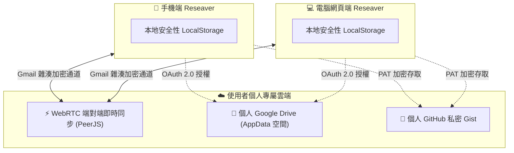

# Reseaver (研究救星) 🎓✨

> **專為研究生（碩士 / 博士）量身打造的全方位研究日常速記、咪挺救星與論文記憶 App**  
> 隨手速記 · 錄音背景保活 · 雙引擎 AI 重點整理 · 數學公式論文膠囊 · 100% 用戶數據自主

🔗 **線上即時體驗網址**：[https://tyc9189354-droid.github.io/Reseaver/](https://tyc9189354-droid.github.io/Reseaver/)

---

## 💡 核心理念 (Core Concept)

在研究所的生活中，時間總是被密集的實驗、閱讀文獻、除錯以及每週的指導教授咪挺（Advisor Meeting）切割得支離破碎。
- **痛點一：咪挺週報手忙腳亂**：每週開會前夕才在回憶過去七天做了什麼，零碎的進展與卡點難以有系統地彙整。
- **痛點二：開會錄音痛點與筆記遺失**：教授語速飛快、中英夾雜，手機常常跳出 App 或螢幕暗掉錄音就中斷；會後重聽錄音更耗費數小時。
- **痛點三：論文讀過就忘、數學公式手打困難**：讀過的經典論文缺乏結構化記憶，要在筆記中手打複雜矩陣與損失函數更是耗時費力。
- **痛點四：隱私與數據自主**：研究進展屬於個人未公開成果，不希望上傳至未知的第三方集中式資料庫。

**Reseaver** 透過「五大核心模組」、「P2P 點對點零洩漏即時同步」與「AI 智能萃取」，將研究生的繁雜日常轉化為井然有序的學術資產。

---

## 🚀 五大核心功能模組 (Core Modules)

### 1. 今日動態 — 10 秒日常速記
- 🚀 **10 秒快速打卡**：隨時記錄「🚀 進展 (Progress)」、「🛑 卡點 (Blocker)」、「❓ 提綱 (Discussion)」、「💡 靈感 (Idea)」與「💼 行政 (Admin)」，並支援自訂標籤分類（如 `#報帳核銷`、`#計畫管考`、`#設備採購`、`#伺服器管理`）。
- 📅 **多會議管理 (Multi-Meeting Manager)**：可自訂多組會議時間（如指導教授咪挺、Lab 團體 Meeting、跨領域合作會議），自動計算精準倒數與每週累積打卡能量。
- 💻 **全設備響應式設計**：在大螢幕電腦端自動展開為現代化雙欄儀表板（左側輸入打卡、右側即時預覽週報連動），手機端自動收合為單欄流式排版。

### 2. 咪挺週報 — 一鍵自動生成週報
- 📄 **智慧聚類標準結構（支援行政第五板塊）**：自動將一週打卡動態彙整為學術標準架構：
  1. 一、本週核心成果與進展 (Key Accomplishments)
  2. 二、遭遇之卡點與技術瓶頸 (Blockers & Bottlenecks)
  3. 三、待討論與指導教授提綱 (Discussion & Agenda)
  4. 四、下週目標與規劃 (Next Steps)
  5. 💼 **五、實驗室行政與專案貢獻 (Lab Administration & Projects)**（可一鍵開關，讓隱形勞動具體可視化）
- 🪄 **AI 學術潤飾**：一鍵將口語化、零碎的日常速記轉換為嚴謹、客觀且專業的高等學術報告語調。
- 📋 **即時匯出**：支援一鍵複製 Markdown、複製純文字或下載 `.md` 報告檔案，開會報告無縫銜接。

### 3. 🎙️ 咪挺摘要 — 背景錄音與 AI 重點萃取
- 🛡️ **背景持續運行錄音 (Background Audio Recording)**：
  - **防睡眠鎖 (Screen Wake Lock API)**：防止系統螢幕超時自動休眠中斷錄製。
  - **無聲音軌保活 (Silent Audio Keep-Alive)**：利用超輕量靜音音軌維持作業系統音訊優先權，即使手機鎖屏或切換到 GoodNotes/Notion 等其他 App，後台錄音依然持續不中斷。
  - **系統多媒體控制中心 (Media Session API)**：手機鎖定畫面上即時顯示錄音狀態，並可直接暫停、繼續或結束。
  - **錄音回放與下載**：錄音結束後自動生成音訊播放器，可一鍵下載留存（`.webm` / `.mp4` / `.wav`）。
- 🗣️ **即時語音轉文字 (STT)**：透過瀏覽器原生語音引擎，會議發言即時轉錄並標註時間戳記。
- 🏷️ **現場打字速記與快捷標籤**：提供快速插入當前時間戳（如 `[05:20]`）與高頻學術標籤（`📌 教授指導`、`⚡ 實驗修改`、`❓ 提問研討`、`🎯 論文方向`、`📋 待辦事項`）。
- 🤖 **AI 智能重點整理雙引擎 (Google Gemini + 離線學術語義規則)**：
  - 專為台灣研究生「中英文夾雜 (Code-switching)」會議語境設計，透過大語言模型前後文校準，自動將同音語音錯字還原為標準學術術語（如將「收塔」校準為 `SOTA`，將「阿布雷森」還原為 `Ablation Study`）。
  - 自動提煉結構化重點與**雙軌待辦分流**：
    1. 📌 **核心決策與研究主軸** (Key Decisions & Direction)
    2. 👨‍🏫 **指導教授關鍵點評與建議** (Advisor Feedback & Comments)
    3. 📋 **指派待辦 Action Items 清單（🎯 論文研究待辦 vs 💼 實驗室行政指派雙軌分流）**
    4. 📅 **下次 Meeting 目標與里程碑** (Next Milestone)
- 📥 **雙向聯動**：支援「一鍵複製完整摘要」、「一鍵將待辦與指導建議匯入咪挺週報（自動對齊研究與行政板塊）」及儲存歷史場次。

### 4. 論文膠囊 — 不限來源 AI 萃取與 KaTeX 數學公式
- ⚡ **通用來源 AI 智能萃取（不限於 arXiv）**：
  - 貼上任意來源：arXiv 網址/ID、DOI、頂級研討會（CVPR, ICLR, NeurIPS 等）、論文 Abstract 摘要文字或 Google Scholar BibTeX。
  - AI 自動分析並秒速填滿：標題、作者、年份會議、🎯 核心問題、⚙️ 創新方法、📈 關鍵成果、⚠️ 研究局限。
- 📐 **數學公式提煉與 LaTeX 支援**：
  - 自動從論文中萃取核心最佳化目標函數（Objective Function）、損失函數（Loss Function）或模型矩陣分解。
  - 內建快捷數學插入按鈕（`📐 目標式`、`🔍 Loss`、`⚡ 矩陣`）。
- 🧮 **KaTeX 期刊級數學公式渲染**：
  - 膠囊卡片與 3D 翻卡模式全面支援 KaTeX 美化排版，將 `$公式$` 或 `$$獨立公式$$` 渲染為 Nature / IEEE 般的專業數學排版。
- 🎴 **3D 沉浸式翻卡記憶 (Flashcards)**：
  - 正面展示論文標題與問題，翻轉背面展示核心技術、數學公式與消融指標。
  - 結合**間隔重複 (Spaced Repetition)** 評分機制，隨時隨地複習重要 Baseline。

### 5. 實驗與知識庫 — 實驗快照、避坑與行政 SOP
- 🧪 **實驗 Run 快照**：記錄模型超參數（Batch Size, Learning Rate, Epoch, Optimizer）與調參結論。
- 🪲 **避坑 Gotchas 知識庫**：專門記錄困擾許久但解法關鍵的環境配置與報錯（如 CUDA OOM, PyTorch DDP 死鎖, NaN Loss, Docker 權限問題）。
- 📌 **行政 SOP 錦囊**：隨時記錄並速查學校統編、經費報帳核銷步驟、GPU 伺服器開帳號與借用規範、口試與公文信件範本。

---

## 🔒 100% 用戶數據自主與雲端同步架構

Reseaver 堅持**用戶隱私第一**，無任何集中式第三方資料庫伺服器儲存您的未公開研究資料：

1. **訪客模式（本地安全儲存）**：未登入時，所有資料 100% 儲存於當前瀏覽器本機，不發送任何資料至伺服器。
2. **Google 官方原生 OAuth 登入 (Google Identity Services)**：內建 Google Client ID，支援直接在手機或瀏覽器上一鍵選擇裝置現有的 Google 帳號。
3. **帳號密碼自主註冊**：支援以任意信箱建立獨立帳密登入。
4. **跨裝置零延遲即時同步 (WebRTC PeerJS)**：登入同一信箱的多台裝置（如手機與電腦），系統會藉由雜湊通道在背景自動建立端對端加密連線，資料直接在裝置間雙向互通。
5. **個人 Google Drive 專屬備份 (AppData Folder)**：資料直連使用者自己的 Google Drive 隱藏應用空間，安全可靠。
6. **離線 JSON 備份與還原**：隨時一鍵導出或載入完整備份檔。

---

## 📲 手機端安裝 (PWA) 與即時熱更新 (OTA)

本專案支援 **PWA（漸進式 Web App）** 標準，無需透過 App Store 即可安裝至手機主畫面：

### 📱 手機安裝步驟：
- **iPhone (iOS Safari)**：
  1. 使用 Safari 開啟 [Reseaver 線上網址](https://tyc9189354-droid.github.io/Reseaver/)。
  2. 點擊瀏覽器下方「**分享**」按鈕 ➔ 選擇「**加入主畫面**」。
  3. 桌面即出現獨立 App 圖示，享受全螢幕無邊框的原生體驗。
- **Android (Chrome)**：
  1. 使用 Chrome 開啟線上網址。
  2. 點擊底部提示「**安裝 Reseaver**」（或右上角選單「加到主畫面」）。

### 🔄 雲端即時熱更新 (OTA Update)：
本專案配置了具備自動快取清理與客戶端接管的 `service-worker.js`。每次程式碼更新推送到 GitHub 後，手機開啟時若檢測到新版本，會立即提示「✨ 檢測到最新更新！」，點擊立即 1 秒無縫切換至最新版。

---

## 🛠️ 技術架構 (Technology Stack)

- **前端核心**：純原生高效能架構 (Vanilla JavaScript ES6+ / HTML5 / CSS3)，啟動速度小於 0.3 秒。
- **UI 框架與圖標**：Tailwind CSS (CDN JIT) + Lucide Icons。
- **數學公式引擎**：KaTeX 0.16.8 + Auto-render extension。
- **音訊與背景多媒體**：
  - Web Audio API (即時音波頻譜視覺化)
  - MediaRecorder API (音訊分段擷取)
  - Screen Wake Lock API (防休眠鎖)
  - Media Session API (作業系統與鎖屏控制整合)
  - Web Speech API (語音辨識 STT)
- **AI 智能引擎**：
  - Google Gemini 1.5 Flash API (支援純文字與多模態學術解構)
  - 內建離線學術語義規則引擎
- **跨裝置與身分驗證**：
  - PeerJS (WebRTC 端對端加密資料通道)
  - Google Identity Services (GIS OAuth 2.0)
  - Google Drive REST API v3
  - GitHub REST API (Gists)

---

## 📄 開源授權 (License)

本專案採用 [MIT License](LICENSE) 授權開源。歡迎學術界與研究同好使用、提出 Issue 或發起 Pull Request 共同改進！
