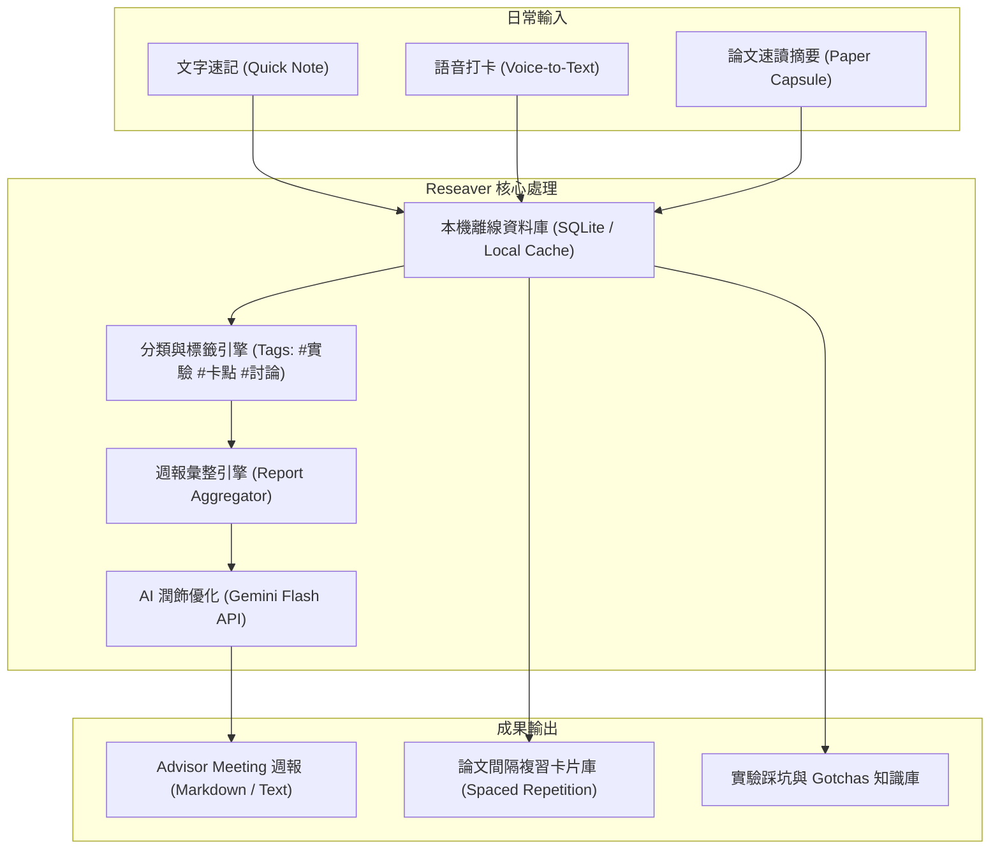
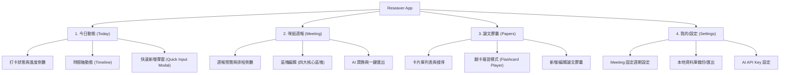

# Reseaver（研究救星）- 產品需求規格書 (PRD)

> **版本**：v1.0.0  
> **更新日期**：2026-11-24  
> **狀態**：審查中 (Under Review)  
> **專案目標**：專為碩士、博士生打造的高效研究日常記錄與 Advisor Meeting 救星手機 App。

---

## 1. 產品概述與背景 (Overview & Problem Statement)

### 1.1 研究生的三大核心痛點
1. **每週咪挺（Advisor Meeting）前焦慮**：每到報告前一天，往往手忙腳亂回憶「這週到底做了什麼」，翻找終端機 log、通訊軟體與草稿紙，耗時費力且經常遺漏關鍵卡點。
2. **文獻零碎時間讀完即忘**：搭車或等實驗時讀完論文，兩週後便忘記其 Baseline、核心方法或架構限制，缺乏結構化的零碎時間複習機制。
3. **實驗踩坑重複發生**：Debug 過程與環境參數隨手寫在不同地方，時間一久重複踩相同的雷。

### 1.2 產品定位與願景
**Reseaver** 取自 **Research + Saver**，致力於成為研究生的掌上研究秘書：
* **極簡輸入**：將每日打卡壓縮在 10 ~ 30 秒以內，降低摩擦力。
* **智慧結構化**：將零星碎片文字自動彙整為符合學術規範的每週進度報告。
* **零碎記憶增強**：透過論文膠囊與翻卡複習，隨時強化對領域論文的熟悉度。

---

## 2. 系統架構與業務流程 (System Flow)



---

## 3. 核心功能模組 (Feature Modules)

### 模組一：咪挺週報救星 (LabPulse / Meeting Prep)
* **極簡日常打卡**：
  * 提供「速記一筆」懸浮按鈕。
  * 支援 4 種快速型態切換：
    * 🚀 **進展 (Progress)**：完成的工作、訓練結果。
    * 🛑 **阻礙/卡點 (Blocker)**：程式報錯、理論推導不順、儀器排程問題。
    * 💡 **靈感/新點子 (Idea)**：看某論文或洗澡時想到的新方向。
    * ❓ **討論事項 (Topic)**：想在下次咪挺請教教授的問題。
* **自動週報彙整引擎**：
  * 自動篩選本週區間的所有紀錄。
  * 按照學術匯報標準生成四大區塊：
    1. **本週成果 (What Was Done)**
    2. **遇到阻礙與已嘗試解法 (Challenges & Attempted Solutions)**
    3. **預計與指導教授討論提綱 (Discussion Topics)**
    4. **下週預計推進目標 (Next Week's Plan)**
* **AI 潤飾擴寫 (Optional)**：
  * 將口語化短句（如：「今天調了 lr=1e-4，loss 有降但後面 overfit」）轉化為書面語：「調整學習率至 1e-4 後前期收斂速度提升，但後期出現過擬合現象，正考慮加入 Dropout 與 Weight Decay」。
* **一鍵匯出**：
  * 支援 Markdown 格式、剪貼簿純文字複製、產生分享圖片。

---

### 模組二：論文膠囊 (PaperCapsule)
* **結構化四維度卡片**：
  * 避免整篇複製摘要，強制提煉 4 個關鍵要素：
    1. **Target Problem**：這篇要解決什麼具體問題？
    2. **Core Method**：它的核心架構/想法是什麼？
    3. **Key Finding**：最突出的指標或消融實驗結論？
    4. **Limitation**：有什麼沒解決的缺點或未來工作？
* **論文間隔重複複習（Flashcard Mode）**：
  * 類似 Anki 模式：正面顯示論文標題與問題，點擊翻轉顯示核心架構與限制。
  * 評分選項：「記得 / 模糊 / 忘了」，演算法自動安排下次複習週期。
* **標籤分類**：
  * 支援主題標籤（例如 `#Diffusion`、`#Quantization`、`#FedLearned`）。

---

### 模組三：實驗隨手日誌 (LabLog & Gotchas)
* **Run Snapshot（實驗版本快照）**：
  * 快速記錄每次實驗的關鍵超參數設定、產出的圖表描述或 Wandb/TensorBoard 連結。
* **踩坑日誌（Bug & Gotchas）**：
  * 專門收錄「困擾好幾天但解法只有一行」的環境配置或程式碼雷點。

---

## 4. UI / UX 資訊架構與分頁規格

App 底部採用 **4-Tab 導覽列** 設計：



### 4.1 Tab 1: 今日動態 (Today)
* **頂部狀態欄**：
  * 顯示目前日期，以及「距離下次 Meeting 倒數 X 天」。
  * 今日記錄進度指示（如：今日已記錄 2 筆）。
* **主內容區（時間軸）**：
  * 依日期降序排列近期記錄卡片。
  * 卡片具備類型色標（進展：綠、卡點：紅、討論：橘、靈感：藍）。
* **底部固定操作鈕（FAB）**：
  * 點擊彈出「極簡輸入框」，支援文字快速輸入與標籤勾選，點擊「儲存」即可完成，全程不超過 10 秒。

### 4.2 Tab 2: 咪挺週報 (Meeting)
* **週期切換列**：
  * 預設為「本週週報」，可切換檢視歷史過去各週已歸檔的週報。
* **報告核心編輯與預覽區**：
  * 4 個折疊式區塊（成果、阻礙、討論、規劃），可手動微調文字或上下拖曳重排。
* **快捷動作按鈕**：
  * 🪄 **「AI 潤飾」**：調用模型重構語氣。
  * 📋 **「複製 Markdown」**：直接可貼到 HackMD、Notion 或投影片備忘錄。
  * 📤 **「匯出為文字 / 圖片」**。

### 4.3 Tab 3: 論文膠囊 (Papers)
* **頂部統計**：
  * 「累計記錄 N 篇」、「今日待複習 M 篇」。
  * 「開始今日翻卡」醒目啟動按鈕。
* **卡片清單**：
  * 支援搜尋與標籤篩選。
  * 卡片顯示標題、年份、關鍵方法標籤。
* **沉浸式翻卡模式 (Card Deck)**：
  * 全螢幕卡片介面，點擊翻面，下方提供「簡單 / 良好 / 困難」記憶回饋按鈕。

### 4.4 Tab 4: 設定與偏好 (Settings)
* **Meeting 週期配置**：
  * 例：「每週四 14:00」，系統自動以此時間為基準結算當週週報。
* **自訂標籤管理**：
  * 自由增刪個人研究領域特有的標籤。
* **本機資料管理**：
  * JSON 格式完整備份與還原。

---

## 5. 資料結構設計 (Data Models)

```typescript
// 1. 日常隨手記錄
interface LogEntry {
  id: string;
  createdAt: string;       // ISO 8601
  category: 'progress' | 'blocker' | 'idea' | 'discussion';
  content: string;
  tags: string[];          // e.g. ['#實驗', '#CVPR25']
  isArchived: boolean;
}

// 2. 彙整週報
interface WeeklyReport {
  id: string;
  startDate: string;
  endDate: string;
  meetingDate: string;
  sections: {
    whatWasDone: string[];
    blockers: string[];
    discussionPoints: string[];
    nextSteps: string[];
  };
  generatedMarkdown: string;
  status: 'draft' | 'finalized';
}

// 3. 論文膠囊
interface PaperCapsule {
  id: string;
  title: string;
  authors: string;
  year: number;
  tags: string[];
  targetProblem: string;
  coreMethod: string;
  keyFinding: string;
  limitation: string;
  reviewSchedule: {
    nextReviewDate: string;
    intervalDays: number;
    repetitionCount: number;
  };
}
```

---

## 6. 技術選型與發布規劃 (Tech Stack & Roadmap)

### 6.1 技術架構
* **跨平台框架**：**React Native + Expo Router (SDK 52+)**
  * 保證一份代碼同時支援 iOS、Android 與 Web。
  * 免本地安裝複雜的 Xcode / Android Studio 即可透過 Expo Go 即時真機除錯。
* **語言與樣式**：**TypeScript + NativeWind (Tailwind CSS for Mobile)**
  * 強型別保障與極速靈活的行動端 UI 設計。
* **離線儲存**：**AsyncStorage / Expo SQLite**
  * 支援免聯網即開即用，研究生在無訊號實驗室或地下室也能順暢紀錄。
* **圖示系統**：**Lucide React Native / Expo Vector Icons**

### 6.2 發布里程碑 (Milestones)
* **M1（本週）**：完成 MVP 前端架構與 Tab1 (今日速記) + Tab2 (週報自動生成) 基礎流程。
* **M2**：接入本機儲存與匯出 Markdown 功能，可真實應用於每週 Meeting。
* **M3**：擴充 Tab3 論文膠囊與翻卡記憶功能，串接 Gemini 輕量 AI 潤飾。
